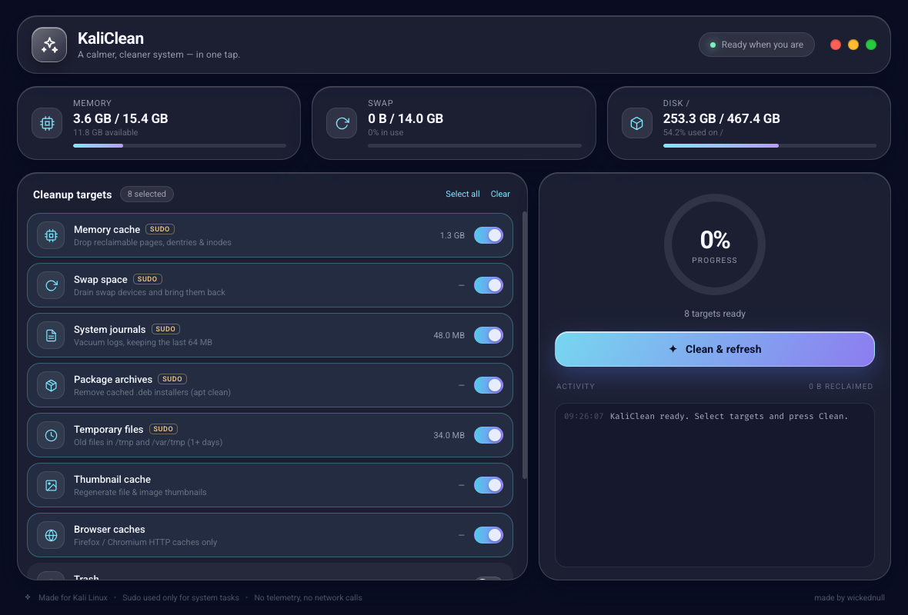

<div align="center">

# ✦ KaliClean

**A frosted-glass system hygiene utility, made for Kali Linux.**

[](https://www.python.org/)
[](https://www.qt.io/)
[](https://www.kali.org/)
[](https://www.kali.org/)
[](LICENSE)
[](https://github.com/wickednull)
[](https://github.com/wickednull/KaliClean/stargazers)
[](https://github.com/wickednull/KaliClean/issues)
[](https://github.com/wickednull/KaliClean/commits/main)



<sub>Frameless, draggable, and unapologetically glassy.</sub>

</div>

---

## ✨ Features

- **iOS-style glass UI** — frosted panels, soft gradients, traffic-light window controls
- **Live system gauges** — RAM, swap, disk, CPU load, temperature, network and uptime refresh automatically
- **10 cleanup targets** — from kernel page caches to browser HTTP caches
- **Secure elevation** — sudo password is requested only when needed and never written to disk
- **Progress ring + activity log** — see exactly what happened and how much space you got back
- **Fast and self-contained** — no pip installs, no build step, no background services
- **Private by design** — no telemetry and no network calls

## 🚀 Quick start

```bash
git clone https://github.com/wickednull/KaliClean.git
cd KaliClean
./run.sh
```

Or launch it directly:

```bash
python3 kaliclean.py
```

**Requirements:** Kali Linux with Python 3, PySide6 and QtWebEngine (all included in a standard Kali install).

## 📦 Installation

Build a Debian package and install it (recommended — integrates with apt and uninstalls cleanly):

```bash
make deb
sudo apt install ./dist/kaliclean_1.0.1_all.deb
```

Or install straight from the checkout without building a package:

```bash
sudo ./install.sh          # remove later with: sudo ./uninstall.sh
```

Both routes install the application to `/usr/share/kaliclean`, add a `kaliclean` command,
a desktop menu entry with the app icon, hicolor icons at every common size and a
man page (`man kaliclean`). Launch it from the applications menu or by typing
`kaliclean`.

Other useful targets: `make icons` regenerates the PNG icons from
`assets/kaliclean.svg`, `make check` runs syntax checks, `make uninstall`
removes a non-package install.

## 🧹 What it cleans

| Target | Action | Sudo |
| --- | :--- | :---: |
| Memory cache | `sync` + `echo 3 > /proc/sys/vm/drop_caches` | ✅ |
| Swap space | `swapoff -a` then `swapon -a` | ✅ |
| System journals | `journalctl --vacuum-size=64M` (keeps recent logs) | ✅ |
| Package archives | `apt-get clean` | ✅ |
| Temporary files | Old regular files (1+ days) in `/tmp` and `/var/tmp` | ✅ |
| Thumbnail cache | `~/.cache/thumbnails` | — |
| Browser caches | Firefox / Chromium HTTP cache folders only | — |
| Trash | `~/.local/share/Trash/{files,info}` *(off by default)* | — |
| Crash reports | `/var/crash` | ✅ |
| DNS resolver cache | Restart `systemd-resolved` *(off by default)* | ✅ |

Select your targets, press **Clean & refresh**, then enter your Kali login password when the elevation dialog appears. Your selection is preserved across the dialog.

## 🛡️ Safety first

- Deletion is limited to known cache/temp directories, **regular files only**, with a minimum age where it matters. Config files, documents and browser profiles are never touched.
- **Trash is off by default** because emptying it is irreversible.
- Swap is always brought back online, even if draining it fails (e.g. when RAM is nearly full).
- The sudo password lives only in process memory. Closing the app discards it.
- Dropping caches releases *reclaimable* memory; caches rebuild naturally, so a short slowdown afterward is normal.

## 🧱 Built with

| Piece | Technology |
| --- | --- |
| Window & events | PySide6 / Qt 6 |
| UI rendering | QtWebEngine + HTML/CSS/JS |
| Python ↔ UI bridge | Qt WebChannel |
| Cleaning engine | Python standard library + system utilities |

## 📁 Project structure

```
KaliClean/
├── kaliclean.py          # app window, WebChannel bridge, worker thread
├── backend.py            # cleanup tasks, size estimates, system stats
├── web/
│   ├── index.html        # the glass UI
│   └── qwebchannel.js    # Qt's WebChannel client
├── assets/
│   ├── kaliclean.svg     # source icon (vector)
│   ├── kaliclean.png     # 256px window icon
│   ├── icons/            # rendered hicolor PNG icons
│   └── render_icons.py   # icon rendering script
├── packaging/
│   ├── build_deb.sh      # .deb builder
│   ├── control           # Debian package metadata
│   ├── com.github.wickednull.KaliClean.desktop  # menu entry
│   ├── kaliclean.launcher
│   ├── com.github.wickednull.KaliClean.metainfo.xml  # software-center metadata
│   ├── kaliclean.1       # man page
│   ├── changelog         # Debian changelog
│   ├── postinst          # cache refresh on install
│   └── postrm            # cache refresh / cleanup on removal
├── docs/
│   └── screenshot.png    # UI preview
├── install.sh            # lightweight system installer
├── uninstall.sh          # matching uninstaller
├── Makefile              # make deb / icons / install / uninstall / check
├── run.sh                # development launcher
├── LICENSE               # MIT
└── README.md
```


## 📄 License

MIT © wickednull. See [LICENSE](LICENSE).

<div align="center">

**Made by [wickednull](https://github.com/wickednull) · Built for Kali Linux**

</div>
